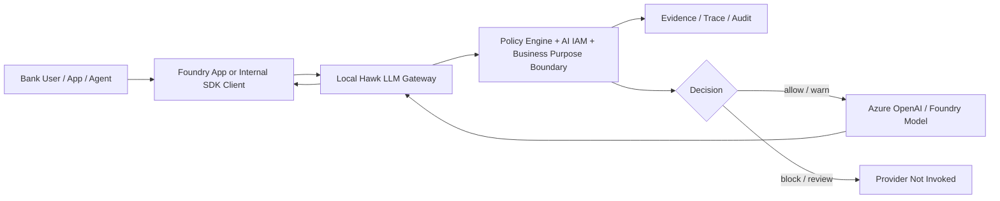
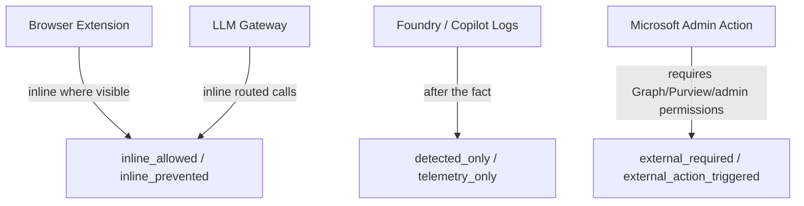

# Bank Azure Foundry Reference Architecture


## Positioning

Hawk is the enterprise AI Action Control Plane for the bank. Azure AI Foundry, Azure OpenAI, M365 Copilot, browser AI, MCP tools, and SDK apps are deployment surfaces. They do not get separate governance systems.

## Local Pilot Flow



## Compatible API Surface

Foundry apps and OpenAI-compatible clients can route through:

```text
POST /openai-compatible/v1/chat/completions
POST /llm-gateway/v1/chat/completions
```

The request uses OpenAI-style `messages`, plus Hawk metadata:

```json
{
  "tenant_id": "...",
  "ai_system_id": "...",
  "policy_version_id": "...",
  "provider": "azure_openai",
  "model": "gpt-4.1",
  "messages": [{"role": "user", "content": "Summarize policy controls"}],
  "metadata": {
    "actor_type": "human",
    "actor_id": "foundry-api-user",
    "context_summary": "azure foundry routed call"
  }
}
```

The response remains OpenAI-shaped and includes Hawk control evidence:

```json
{
  "object": "chat.completion",
  "choices": [{"message": {"role": "assistant", "content": "..."}}],
  "hawk": {
    "final_decision": "allow",
    "control_mode": "inline_allowed",
    "ai_action": {},
    "policy_snapshot": {},
    "decision_explanation": {},
    "evidence_bundle": {}
  }
}
```

## Blocked Request Behavior

If Hawk blocks the request, the provider is not invoked:

```text
HTTP 403
error.code = hawk_policy_block
hawk.control_mode = inline_prevented
```

This gives the bank a clean proof point: high-risk prompts, secrets, customer data, or out-of-purpose actions are stopped before Azure OpenAI/Foundry receives the request.

## Data Residency

For the local pilot:

- Gateway decisions live in local PostgreSQL.
- Evidence bundles and reports live on the local API machine.
- Prompt contents are stored according to Hawk storage policy: raw for low sensitivity only, redacted or hashed for sensitive cases.
- Provider credentials remain server-side and are not returned in config/log/event APIs.

## Control-Mode Limits



Hawk must not claim prevention unless traffic was routed through the browser extension, LLM gateway, MCP gateway/proxy, SDK wrapper, or another inline path.

