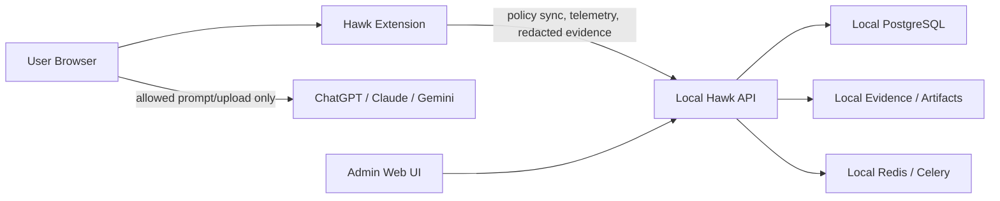
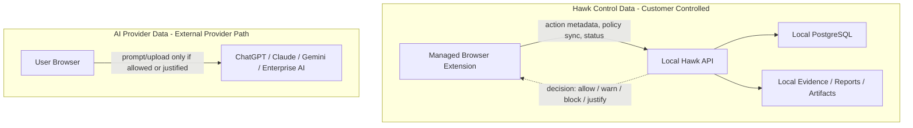
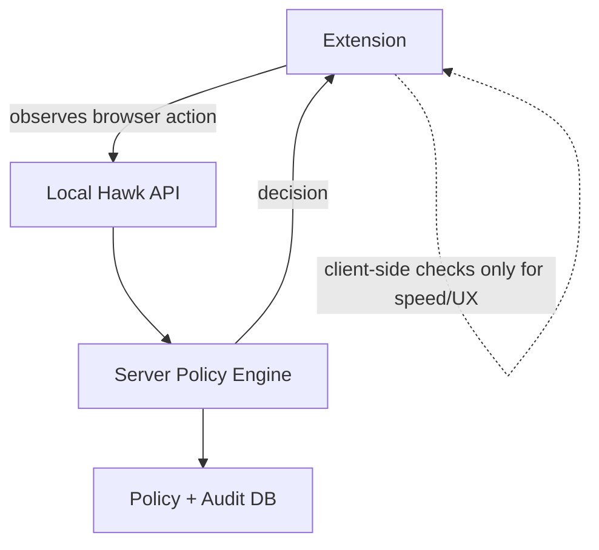
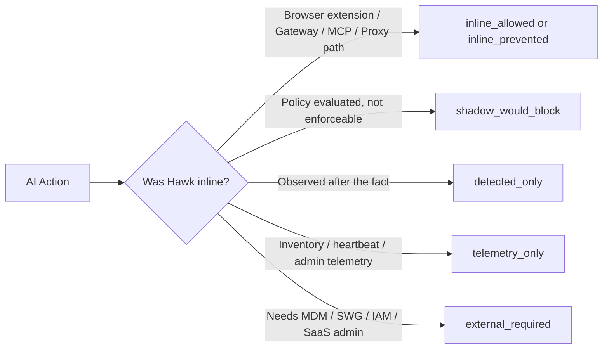
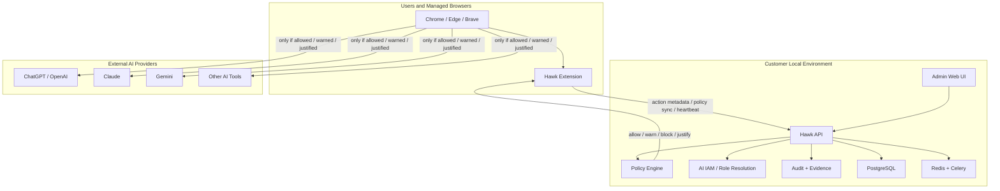

# Hawk AI Local Pilot: Data Residency, Data Flow, and Extension Security

> Imported reference documentation from the selected original worktree. Prior deployment, version and test claims below are historical source context, not current acceptance. See [the collaboration README](../README.md) for verified results and remaining limits. Commands require an isolated, explicitly configured environment.


Audience: CISO, Security, IT, Infrastructure, Compliance

Purpose: explain where Hawk AI pilot data moves, where it lives, what the browser extension can and cannot see, and what must be hardened before a 50-user local deployment.

## Executive Summary

For the local pilot, Hawk customer data should live on the customer-controlled API machine, not in Hawk cloud.

Hawk control data flows from the managed browser extension to the local Hawk API, then into local PostgreSQL and local evidence/artifact storage. The user’s actual AI prompt or upload goes to ChatGPT, Claude, Gemini, or another AI provider only when Hawk allows, warns, or approves the action.

Hawk is not an EDR, MDM, packet sniffer, or full network inspection product. In the browser pilot, Hawk provides inline control for managed browser AI usage. Desktop apps, CLI/API usage, unmanaged browsers, and network-wide traffic require later gateway, proxy, SWG, MCP, or endpoint integrations.

The browser extension can technically be inspected like any browser extension. Hawk’s security model therefore does not depend on hiding JavaScript. The extension is an enforcement sensor/actuator. Server-side policy, server-side role resolution, evidence, audit, and managed deployment are the actual control boundary.

## Local Pilot Architecture



The pilot has two separate data paths:

1. Hawk control data: browser extension to local Hawk API to local database/evidence storage.
2. AI provider data: user browser to public or enterprise AI provider, only after Hawk allows, warns, or approves the action.



## Where Data Lives

For the local 50-user deployment:

| Data Type | Where It Lives |
|---|---|
| Users, tenant, roles, policy mappings | Local PostgreSQL |
| Devices, browsers, extension versions | Local PostgreSQL |
| AI actions and prompt metadata | Local PostgreSQL |
| Findings and alerts | Local PostgreSQL |
| Evidence bundles | Local DB plus local evidence/artifact folders |
| Policy versions and snapshots | Local PostgreSQL |
| Report and PDF exports | Local artifact/export folder |
| Redis queues and worker state | Local Redis |
| Extension auth/session tokens | Browser extension/session storage |
| Raw prompts/files | Redacted, hashed, or stored based on sensitivity policy |

Customer residency position:

> Hawk telemetry, decisions, evidence, reports, and audit data stay inside the customer-controlled local deployment. No Hawk cloud is required for this pilot. The only external data movement is the user’s actual AI interaction with public or enterprise AI tools, and Hawk’s purpose is to block, warn, or require justification before that happens.

AI provider residency and retention are separate from Hawk. If users submit data to ChatGPT, Claude, Gemini, Azure OpenAI, Microsoft Copilot, or another AI provider, that provider’s enterprise settings and contract govern that external path.

## What the Extension Can See

The browser extension can see and control only the surfaces where it is installed, enabled, permitted by browser policy, and technically able to observe browser events.

The extension can see:

- Pages and domains where it is allowed to run
- Prompt input boxes on supported browser AI apps
- Paste events
- File upload and drag/drop events where browser APIs expose them
- Copy/output events where visible
- Extension heartbeat and policy sync state
- Browser, device, extension version, and endpoint metadata

The extension cannot see:

- All device network traffic
- All TLS traffic
- Native desktop app traffic
- Other browsers where the extension is not installed
- Unmanaged/incognito sessions unless extension is explicitly enabled there
- AI usage on another device
- API, CLI, SDK, or developer-tool traffic unless routed through Hawk Gateway/proxy/MCP paths later

CISO-safe wording:

> Hawk provides inline browser control for managed browser AI usage. It is not an EDR or packet sniffer. Network-wide or desktop-wide prevention requires gateway, proxy, SWG, endpoint, or MCP integration.

## Extension Security Model

Browser extensions are not secret. A user with access to the unpacked extension can inspect JavaScript. Hawk must not rely on hidden client-side logic for security.

The safe design is:



Security principle:

> The extension is an enforcement sensor and actuator, not the source of truth. Real policy decisions, role resolution, tenant policy, evidence, and audit live server-side.

For the pilot, the extension package should be hardened so users cannot casually read source maps, tests, comments, or dev files. That reduces casual reverse engineering, but it is not the security boundary.

## Extension Hardening Status

The pilot extension package should meet the following requirements before broad sharing:

| Control | Required Status |
|---|---|
| No `.map` source map files | Required |
| No source, test, or dev files in package | Required |
| Comments stripped or minified build | Required |
| Optional JavaScript obfuscation | Recommended |
| Build hash/version reported to backend | Required |
| Tokens not sent in telemetry | Required |
| Tokens not stored in evidence, logs, or reports | Required |
| Backend URL locked in managed mode | Recommended |
| Tenant ID locked in managed mode | Recommended |
| User cannot change policy mode in managed mode | Recommended |
| Extension version drift finding | Recommended |
| Incognito disabled or explicitly managed | Required decision |

Current implementation intent for hardened local deployment:

- Packaged extension build excludes source maps and development/test files.
- Extension reports version and build hash to the backend.
- Extension telemetry avoids sending auth tokens.
- Backend sanitization prevents tokens from leaking into telemetry, evidence, logs, and reports.
- Managed mode can lock tenant/API settings and disable user-editable backend changes.
- Active URL telemetry should strip query strings and fragments before storage.

Recommended CISO wording:

> The extension can technically be inspected like any browser extension, but the security model does not depend on hidden client code. Sensitive policy decisions happen on the server. The packaged pilot build removes source maps and development files, reports its version/hash, and avoids leaking tokens into telemetry, evidence, logs, or reports.

## Control-Mode Honesty

Hawk must clearly label what it actually controlled versus what it only observed.



Control-mode definitions:

| Mode | Meaning |
|---|---|
| `inline_prevented` | Hawk blocked before execution on an inline path |
| `inline_allowed` | Hawk allowed before execution on an inline path |
| `warned` | Hawk warned the user and logged the action |
| `shadow_would_block` | Hawk policy would have blocked, but enforcement was not inline |
| `detected_only` | Hawk detected after execution or via logs |
| `telemetry_only` | Hawk received inventory/status telemetry only |
| `external_required` | A third-party control is required to enforce |
| `external_action_triggered` | Hawk successfully triggered an external workflow |
| `incomplete` | Attribution, evidence, or path confidence is incomplete |

This avoids overclaiming. It also gives the CISO a clear path for expanding coverage:

- Browser AI: inline when extension is installed and managed.
- Gateway/API/SDK AI: inline when routed through Hawk Gateway.
- MCP/developer tools: inline when routed through Hawk MCP Gateway or proxy.
- Desktop native apps: telemetry/detected unless routed through Local AI Proxy, SWG, or endpoint control.
- SaaS/Copilot: telemetry/external-required unless the SaaS exposes an inline control hook.

## Main Residency Pain Points

The CISO will likely ask the following:

### Does Hawk send telemetry to a vendor cloud?

No, not in the local deployment. Hawk telemetry, decisions, evidence, reports, and audit data remain on the local API machine and local database.

### Where is the database?

On the customer-controlled local API machine PostgreSQL instance.

### Where are reports and evidence stored?

On the customer-controlled local API machine in the database and configured evidence/artifact/export folders.

### Do raw prompts get stored?

Only according to storage policy:

| Sensitivity | Storage Behavior |
|---|---|
| Low sensitivity | Raw prompt or readable summary may be stored if policy allows |
| Medium sensitivity | Redacted prompt and metadata |
| High sensitivity | Hash, metadata, entity counts, and redacted summaries only |

Recommended strict pilot posture:

- Do not store raw secrets.
- Do not store raw passwords.
- Do not store raw private keys.
- Do not store full payment credentials.
- Do not store full customer/contact lists unless explicitly configured.
- Prefer redacted evidence, hashes, counts, and short summaries.

### Can AI providers still receive data?

Yes, only when the user submits to them and Hawk allows, warns, or accepts justification. Hawk does not replace the AI provider’s own processing or retention obligations.

### Can users bypass by using another browser or device?

Yes, unless deployment is managed with browser policy, MDM, SWG/proxy, gateway controls, or other enterprise enforcement. Hawk must label bypassed or unseen surfaces honestly.

## Recommended CISO Statement

> Hawk is deployed locally for this pilot. The browser extension observes AI usage in managed browsers and sends action metadata to the local Hawk API. The API evaluates policy locally, stores decisions and evidence locally, and returns allow, warn, block, or justification decisions to the extension. No Hawk cloud is required.
>
> The extension does not inspect all network traffic and does not claim endpoint-wide prevention. It controls what it can see in the browser. For desktop apps, CLI tools, unmanaged devices, or SaaS-only telemetry, Hawk labels activity as telemetry-only, detected-only, or external-required unless traffic is routed through a Hawk gateway, proxy, or supported enforcement path.
>
> For privacy, Hawk stores redacted evidence, hashes, entity counts, and policy decisions for sensitive events rather than raw secrets or full customer data. The extension package is hardened for pilot distribution, but the real security boundary is server-side policy and managed deployment, not obscurity of browser JavaScript.

## Deployment Hardening Checklist Before 50 Users

Infrastructure:

- Use local PostgreSQL with disk encryption.
- Run API over HTTPS if possible, even internally.
- Restrict API port to the internal network only.
- Use a strong `SECRET_KEY`.
- Back up PostgreSQL securely.
- Run Redis/Celery locally for policy sync, background checks, and reports.
- Set retention policy for evidence, reports, and artifact folders.

Identity and access:

- Rotate pilot passwords before broad rollout.
- Prefer company SSO later.
- Ensure users are mapped to the correct tenant.
- Ensure user roles/business functions are resolved server-side.
- Do not trust extension-provided role data.

Managed extension:

- Enable managed browser extension policy.
- Lock API URL and tenant ID.
- Disable user-editable backend settings in managed mode.
- Confirm source maps are removed from extension package.
- Confirm source/test/dev files are not included.
- Confirm extension version/hash appears in backend.
- Confirm extension heartbeat is visible per user/device.
- Decide incognito policy: disabled or explicitly enabled and monitored.

Data protection:

- Confirm no tokens appear in telemetry, evidence, logs, or reports.
- Confirm report exports redact sensitive prompts.
- Confirm high-sensitivity events store hashes/metadata/entity counts, not raw data.
- Confirm stack traces do not print sensitive payloads in API logs.
- Confirm evidence/artifact exports are stored locally and access-controlled.

Operational validation:

- Test policy sync.
- Test browser telemetry lag.
- Test prompt block.
- Test file upload block.
- Test justification flow.
- Test user/device attribution.
- Test report export redaction.
- Test extension version drift detection.
- Test unmanaged/incognito behavior.
- Test API health and schema health.

## 50-User Readiness Gate

Before enrolling pilot users, run the strict readiness gate against the exact API `.env` and the exact extension package folder that will be distributed:

```bash
python3 scripts/pilot_deployment_readiness.py \
  --api-env apps/api/.env \
  --extension-dir /path/to/hawk-extension-pilot-<version>-<hash> \
  --expected-api-url https://<customer-api-host> \
  --expected-web-origin https://<admin-ui-host> \
  --expected-tenant-id <tenant-uuid> \
  --strict-50-user
```

In `--strict-50-user` mode, Hawk fails the gate if rollout-critical controls are missing:

- HTTPS for API and UI origins
- Strong local secrets and locked managed extension policy
- Exact managed extension API URL, tenant ID, and minimum version
- Source-map/dev-file/package hygiene checks
- Extension version/hash metadata
- Redis/Celery worker configuration
- Fail-secure governance dependency checks
- Evidence/report retention configuration
- PostgreSQL backup, disk encryption, and API network restriction attestations
- Raw sensitive prompt logging disabled

Local lab demos can still run without this flag, but a 50-user pilot should not.

## Architecture Summary for Deployment Briefing



Short deployment line:

> Hawk’s local pilot keeps governance, audit, evidence, reports, and policy decisions inside the customer environment. The browser extension enforces where it is installed and managed. Broader coverage is added by routing additional AI surfaces through Hawk Gateway, MCP Gateway, SWG/proxy, or SaaS integrations.

## Related Local Files

Relevant hardening and operations references in this repo:

- `docs/DEPLOYMENT_HARDENING_50_USER_PILOT.md`
- `scripts/backup_postgres.sh`
- `scripts/backup_postgres.ps1`
- `scripts/prune_pilot_artifacts.py`
