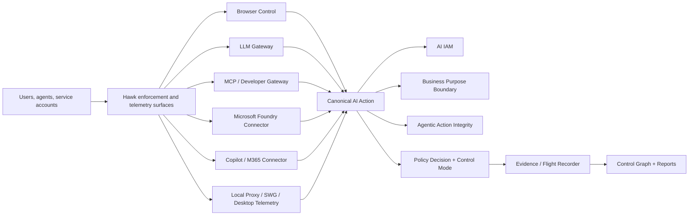

# Microsoft Foundry and Copilot Surfaces


Hawk treats Microsoft Foundry and Microsoft Copilot as first-class surfaces inside the existing AI Action Control Plane. They are not separate product modules.

## Control Plane Flow



## Foundry Coverage

The Foundry surface captures:

- Foundry agent identity
- initiating user / Entra user where available
- Foundry project, workspace, subscription, and resource group metadata
- model and model version
- model deployment / deployment ID
- tool calls
- data sources / knowledge stores
- connected authority such as managed identity, service principal, OAuth grant, or API key metadata
- gateway routed status
- policy decision and evidence
- Agent Touchpoint Graph edges for user -> agent -> authority/model/tool/data source/API
- blast-radius inputs for reachable tools, data sources, SaaS apps, and identities

Control-mode honesty:

- Foundry events from logs, diagnostics, admin APIs, or connectors are `telemetry_only` or `detected_only`.
- Foundry API or agent traffic routed through Hawk Gateway can be `inline_allowed` or `inline_prevented`.
- Hawk does not claim prevention for Foundry actions it only saw after execution.

### Foundry Event Contract

`POST /surface-coverage/microsoft/foundry/events` accepts Microsoft Foundry telemetry and gateway-routed events with these important fields:

- `project_id`, `project_name`, `workspace_id`
- `subscription_id`, `resource_group`
- `agent_id`, `agent_name`
- `model`, `model_version`, `model_deployment`, `model_deployment_id`
- `tool`, `tool_names`
- `data_source`, `data_source_ids`
- `service_principal_id`, `managed_identity_id`, `entra_app_id`
- `authority`
- `gateway_routed`

For connector/log events, Hawk records these as `telemetry_only` touchpoints. If the same traffic is routed through the Hawk Gateway, the control mode can become `inline_allowed`, `warned`, or `inline_prevented` based on the actual decision path.

### Foundry Live Inventory Sync

`POST /surface-coverage/microsoft/foundry/sync` pulls Foundry inventory into the same AI Action, AI IAM, Runtime Intelligence, Control Graph, and Evidence spine.

The live connector can pull:

- Foundry projects
- Foundry agents
- model deployments
- model catalog records
- service principals / Entra app identities
- agent tools
- agent data sources

Example live payload:

```json
{
  "project_endpoint": "https://ai.azure.com/projects/customer-risk-prod",
  "access_token": "<azure-access-token>",
  "gateway_routed_agent_ids": ["agent-customer-risk-reviewer"],
  "timeout_seconds": 10
}
```

The connector calls these project-scoped endpoints by default:

```text
GET {project_endpoint}/projects?api-version=2025-05-01-preview
GET {project_endpoint}/agents?api-version=2025-05-01-preview
GET {project_endpoint}/deployments?api-version=2025-05-01-preview
GET {project_endpoint}/models?api-version=2025-05-01-preview
GET {project_endpoint}/servicePrincipals?api-version=2025-05-01-preview
GET {project_endpoint}/tools?api-version=2025-05-01-preview
GET {project_endpoint}/dataSources?api-version=2025-05-01-preview
```

If a customer tenant uses different Azure or Foundry endpoint paths, pass explicit endpoint overrides:

```json
{
  "access_token": "<azure-access-token>",
  "endpoints": {
    "projects": "https://example.azure.com/projects",
    "agents": "https://example.azure.com/agents",
    "deployments": "https://example.azure.com/deployments",
    "models": "https://example.azure.com/models",
    "service_principals": "https://example.azure.com/servicePrincipals",
    "tools": "https://example.azure.com/tools",
    "data_sources": "https://example.azure.com/dataSources"
  }
}
```

For local demos or offline testing, send an `inventory` object instead of an access token. This exercises the same normalization path without calling Azure:

```json
{
  "inventory": {
    "projects": [{"id": "project-1", "name": "Customer Risk"}],
    "agents": [{
      "id": "agent-1",
      "name": "Risk Reviewer",
      "project_id": "project-1",
      "model": "gpt-4.1",
      "service_principal_id": "sp-1",
      "tools": ["read_case"],
      "data_sources": ["customer-vector"]
    }],
    "deployments": [{"id": "dep-1", "name": "gpt-4.1-prod", "project_id": "project-1"}],
    "models": [{"id": "model-1", "name": "gpt-4.1", "provider": "azure_openai"}],
    "service_principals": [{"id": "sp-1", "displayName": "Risk Reviewer SP"}],
    "tools": [{"id": "tool-1", "name": "write_case", "agent_id": "agent-1"}],
    "data_sources": [{"id": "crm", "name": "CRM", "agent_id": "agent-1"}]
  }
}
```

Sync output includes:

- `sync_id`
- `events_created`
- pulled inventory counts
- affected agents
- affected projects
- affected models
- control mode

Control-mode rules:

- Inventory-only sync is `telemetry_only`.
- A synced agent listed in `gateway_routed_agent_ids` becomes `inline_candidate`.
- Hawk can only claim `inline_prevented` for the actual Foundry agent/model/tool call when it is routed through Hawk Gateway, MCP Gateway, SDK, or another inline enforcement path.

Sensitive-data handling:

- The Azure access token is only used as an outbound Authorization header.
- Tokens, secrets, connection strings, certificates, and passwords are excluded from record summaries and hashes.
- Runtime metadata stores record IDs, names, hashes, counts, model/tool/data-source references, and redacted summaries.

Where it appears:

- `/surface-coverage` Microsoft AI Surface coverage
- Runtime events filtered by `source_surface=foundry`
- AI IAM agent details
- Agent Touchpoint Graph
- Agent Blast Radius
- Evidence and reports for any resulting findings

Current pilot limitation:

This repository validates the live HTTP connector contract with mocked Azure responses. A real customer tenant validation still requires Azure/Foundry credentials and exact customer endpoint shape.

## Copilot Coverage

The Copilot surface captures:

- Microsoft 365 Copilot prompt/activity events where available
- Office Copilot context such as Word, Excel, and PowerPoint
- Copilot Studio agent actions
- Copilot Studio connector names, OAuth scopes, DLP/policy metadata, and environment IDs
- Copilot Studio agent identity and connector touchpoints
- Graph, Purview, and admin telemetry as evidence/visibility inputs

Control-mode honesty:

- Copilot web usage in a managed browser can be inline controlled by the browser extension.
- M365 app Copilot telemetry is generally `telemetry_only` unless Microsoft exposes an inline enforcement path.
- Copilot Studio connector events are treated as traceable agentic actions; prevention requires an inline gateway, policy hook, or external admin enforcement integration.

### Copilot Live Inventory Sync

`POST /surface-coverage/microsoft/copilot/sync` pulls Microsoft 365 Copilot, Copilot Studio, Graph, and Purview inventory into the same AI Action, Runtime Intelligence, AI IAM, Control Graph, and Evidence spine.

The live connector can pull:

- Microsoft 365 Copilot activity where available
- Copilot Studio agents
- Copilot Studio connectors/tools
- Copilot-related OAuth apps/service principals
- Microsoft Purview sensitivity/data-protection signals
- Microsoft Graph permission/service-principal records

Example live payload:

```json
{
  "tenant_graph_endpoint": "https://graph.microsoft.com/beta",
  "copilot_studio_endpoint": "https://api.powerplatform.com/copilotstudio",
  "access_token": "<graph-or-power-platform-access-token>",
  "gateway_routed_agent_ids": ["studio-agent-customer-support"],
  "timeout_seconds": 10
}
```

The connector calls these endpoints by default:

```text
GET {tenant_graph_endpoint}/copilot/activity
GET {copilot_studio_endpoint}/agents
GET {copilot_studio_endpoint}/connectors
GET {tenant_graph_endpoint}/servicePrincipals
GET {tenant_graph_endpoint}/security/informationProtection/sensitivityLabels
GET {tenant_graph_endpoint}/servicePrincipals
```

If a customer tenant uses different Microsoft Graph, Power Platform, or internal proxy paths, pass explicit endpoint overrides:

```json
{
  "tenant_graph_endpoint": "https://graph.microsoft.com/beta",
  "copilot_studio_endpoint": "https://api.powerplatform.com/copilotstudio",
  "access_token": "<access-token>",
  "endpoints": {
    "m365_activity": "https://graph.microsoft.com/beta/copilot/activity",
    "copilot_studio_agents": "https://api.powerplatform.com/copilotstudio/agents",
    "connectors": "https://api.powerplatform.com/copilotstudio/connectors",
    "oauth_apps": "https://graph.microsoft.com/beta/applications",
    "purview_signals": "https://graph.microsoft.com/beta/security/informationProtection/sensitivityLabels",
    "graph_permissions": "https://graph.microsoft.com/beta/servicePrincipals"
  }
}
```

For local demos or offline testing, send an `inventory` object instead of an access token. This exercises the same normalization path without calling Microsoft APIs:

```json
{
  "inventory": {
    "m365_activity": [{"id": "act-1", "userPrincipalName": "user@example.com", "workload": "Teams"}],
    "copilot_studio_agents": [{"id": "agent-1", "displayName": "Support Agent", "connectors": ["Dynamics 365"]}],
    "connectors": [{"id": "conn-1", "name": "Dynamics 365", "agentId": "agent-1"}],
    "oauth_apps": [{"id": "app-1", "displayName": "Support Agent OAuth", "agentId": "agent-1"}],
    "purview_signals": [{"id": "label-1", "sensitivityLabel": "Confidential"}],
    "graph_permissions": [{"id": "sp-1", "agentId": "agent-1", "permissionScopes": ["Files.Read.All"]}]
  }
}
```

Sync output includes:

- `sync_id`
- `events_created`
- pulled inventory counts
- affected agents
- affected users
- affected apps
- control mode

Control-mode rules:

- Microsoft 365 Copilot activity, Graph/Purview telemetry, and connector-only logs remain `telemetry_only` unless the action is routed through an inline Hawk path.
- Copilot Studio agents, connectors, OAuth apps, and Graph permission records listed in `gateway_routed_agent_ids` are marked `inline_candidate`.
- Hawk can only claim `inline_prevented` for an actual Copilot Studio agent/tool/model call when it is routed through Hawk Gateway, MCP Gateway, SDK, or another inline enforcement path.
- Remediation actions against Microsoft admin controls are `external_required` or `external_action_triggered`, never fake inline control.

Sensitive-data handling:

- The Microsoft access token is only used as an outbound Authorization header.
- Tokens, secrets, connection strings, certificates, and passwords are excluded from record summaries and hashes.
- Runtime metadata stores IDs, names, hashes, counts, OAuth scope names, data-source references, sensitivity labels, and redacted summaries.

Where it appears:

- `/surface-coverage` Microsoft AI Surface coverage
- Runtime events filtered by `source_surface=copilot`
- AI IAM agent details for Copilot Studio agents
- Agent Touchpoint Graph
- Agent Blast Radius
- Evidence and reports for resulting findings

Current pilot limitation:

This repository validates the live HTTP connector contract with mocked Microsoft responses. A real customer tenant validation still requires Microsoft Graph, Purview, and Power Platform credentials plus exact customer endpoint shape.

## Positioning

Hawk does not compete by claiming every Microsoft AI interaction is automatically blocked inline. Hawk competes by proving the action chain:

AI action -> actor / authority -> Foundry or Copilot surface -> policy snapshot -> decision -> control mode -> evidence -> Control Graph.

This is the difference between interaction inspection and action integrity.
