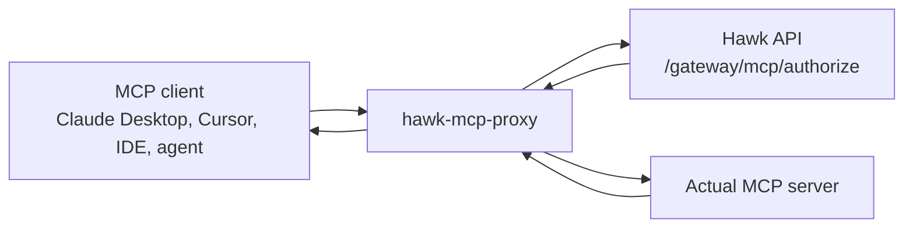

# Hawk MCP Proxy

Vendor-neutral stdio bridge for routing MCP clients through Hawk AI Action Control.

The proxy is not Claude-specific. Any MCP client that launches local stdio MCP servers can point at `hawk-mcp-proxy` instead of the real server command.

## Flow



## What It Does

- Parses standard newline-delimited MCP JSON-RPC over stdio by default.
- Preserves the legacy `Content-Length` transport behind an explicit flag.
- Scans tools returned by `tools/list` with `/gateway/mcp/tools/scan`.
- Authorizes every `tools/call` with `/gateway/mcp/authorize`.
- Blocks denied tool calls before they reach the underlying MCP server.
- Redacts secret-like arguments in metadata summaries.
- Optionally inspects visible textual `tools/call` results locally and attaches
  bounded, proxy-owned taint metadata before forwarding.
- Advertises a standard MCP Apps governed-status resource on scanned tools.
  Claude Desktop and other compatible hosts render Hawk's verified decision
  inline; clients without MCP Apps support keep the normal text/error result.

## Native Governed Status

Every approved proxied tool advertises `ui://hawk/governance/status.html` using
the MCP Apps metadata contract. The proxy serves that resource itself and adds
only proxy-owned governance metadata after Hawk authorizes the call. Child
servers cannot claim or overwrite Hawk governance state.

The view reports `Governed` only when the returned decision proves an inline
control mode and includes an evidence reference. Inline decisions without
evidence display `Partially governed`; monitor paths display `Monitor only`;
missing or unsupported claims display `Unknown`. Token use remains `Unknown`
unless a trusted provider or client hook supplies it.

This produces an inline native host card, not an unsupported modification to a
client's permanent application chrome. Compatible MCP Apps hosts render the
card inside the conversation; other clients receive the same decision through
the ordinary MCP result or error envelope.

## Tool Result Inspection

Tool-result inspection is default-off. Enable it explicitly for a deployed proxy:

```bash
HAWK_MCP_RESULT_INSPECTION_ENABLED=true hawk-mcp-proxy ...
```

The default inspection budget is 256 KiB of visible text. Override it with a
positive byte count in `HAWK_MCP_RESULT_INSPECTION_MAX_BYTES`.

When enabled, the proxy inspects successful `tools/call` text, embedded textual
resources, and structured content for deterministic signals covering
credentials, excess customer data, instruction injection, external URLs,
future actions, and persistent-memory instructions. It writes only fixed labels
and status fields under `result._meta["ai.hawk/result-inspection"]`; it does not
send or log raw result content. Existing metadata in that namespace is
overwritten so a child server cannot claim Hawk inspection.

Tainted content remains visible with an `outcome` of `tainted`; this slice adds
inspection and provenance, not a new backend enforcement contract. Malformed or
over-budget inspectable output fails closed with a generic JSON-RPC error. For
the explicitly supported MCP 2025-06-18 result shape, required fields and types are
validated for text, image, audio, embedded-resource, resource-link, and
structured-content variants before any trusted inspection marker is emitted.
Binary-only output is reported honestly as `visible_non_text` and
`not_inspected`; mixed text/binary output is `visible_mixed` and cannot receive
a clean outcome for the whole result.
When inspection is disabled, no inspection marker is added and any child-forged
marker in Hawk's reserved namespace is removed.

## Install For Local Testing

From this package folder:

```bash
npm link
```

Verify:

```bash
hawk-mcp-proxy --help
```

## Stdio Transport

Real MCP clients such as Codex use newline-delimited JSON-RPC. The proxy now
uses that transport by default on both the client and child-server boundaries:

```bash
hawk-mcp-proxy --stdio-framing ndjson -- node server.mjs
```

The older manual lab remains available with explicit legacy framing:

```bash
hawk-mcp-proxy --stdio-framing content-length -- node legacy-server.mjs
```

`HAWK_MCP_STDIO_FRAMING` accepts the same two values. Unsupported values fail
before the child process starts; framing is never auto-detected or downgraded.

## Codex Demo Registration

First export a short-lived access token obtained from the local Hawk API. Then
run this command from any directory:

```zsh
codex mcp add hawk-demo \
  --env HAWK_API_URL=http://127.0.0.1:8000 \
  --env HAWK_TENANT_ID=9300801c-8597-4813-ad44-ddc5a88ec5a6 \
  --env HAWK_ACCESS_TOKEN="$HAWK_ACCESS_TOKEN" \
  --env HAWK_AI_SYSTEM_ID=13a2e2e7-7ae6-454b-8bae-ab1d1946ea99 \
  --env HAWK_ACTOR_ID=owner@acme.ai \
  --env HAWK_MCP_SERVER_ID=manual-terminal-lab \
  --env HAWK_SESSION_ID=codex-demo-block-session \
  --env HAWK_MCP_LAB_DIR=/private/tmp/hawk-mcp-terminal-lab-codex-demo \
  --env HAWK_MCP_STDIO_FRAMING=ndjson \
  -- /usr/local/bin/node "/Volumes/X10 Pro/New project/repo/packages/hawk-mcp-proxy/bin/hawk-mcp-proxy.mjs" \
  -- /usr/local/bin/node "/Volumes/X10 Pro/New project/repo/packages/hawk-mcp-proxy/examples/manual-terminal/manual-mcp-server.mjs"

codex mcp list
```

Restart Codex after registration. In a new Codex task, use `/mcp` to confirm
`hawk-demo` exposes `write_demo_marker`, then ask Codex to call it with a short
note. For the governed deny proof, Hawk must record the block and
`/private/tmp/hawk-mcp-terminal-lab-codex-demo/marker.json` must remain absent.

The registration contains the short-lived token in Codex configuration. Remove
it immediately after the demo or when the token expires:

```zsh
codex mcp remove hawk-demo
unset HAWK_ACCESS_TOKEN
```

This path validates Hawk's MCP Gateway. It does not validate the separate
OpenAI-compatible LLM Gateway.

## Codex Through The Endpoint Agent

Use endpoint mode when the local Hawk Endpoint Agent owns the MCP decision.
This mode connects to the agent's user-restricted Unix socket and does not
require `HAWK_API_URL`, `HAWK_TENANT_ID`, or `HAWK_ACCESS_TOKEN` in the proxy
process:

```zsh
export HAWK_ENDPOINT_SOCKET="$HOME/.config/hawk/agent.sock"
export HAWK_ENDPOINT_DEVICE_THUMBPRINT="$(jq -er '.ipc_trusted_device_thumbprint' "$HOME/Library/Application Support/Hawk/EndpointAgent/state/endpoint-agent.json")"

codex mcp add hawk-endpoint \
  --env HAWK_ENDPOINT_SOCKET="$HAWK_ENDPOINT_SOCKET" \
  --env HAWK_ENDPOINT_DEVICE_THUMBPRINT="$HAWK_ENDPOINT_DEVICE_THUMBPRINT" \
  --env HAWK_MCP_SERVER_ID=filesystem \
  --env HAWK_SESSION_ID=codex-endpoint-session \
  --env HAWK_MCP_STDIO_FRAMING=ndjson \
  -- /usr/local/bin/node "/Volumes/X10 Pro/New project/repo/packages/hawk-mcp-proxy/bin/hawk-mcp-proxy.mjs" \
  -- /path/to/the/real/mcp-server command-argument
```

The equivalent direct option is:

```zsh
hawk-mcp-proxy \
  --endpoint-socket "$HOME/.config/hawk/agent.sock" \
  --endpoint-device-thumbprint "$HAWK_ENDPOINT_DEVICE_THUMBPRINT" \
  --session-id codex-endpoint-session \
  --server-id filesystem \
  -- node server.mjs
```

When `--endpoint-socket` or `HAWK_ENDPOINT_SOCKET` is selected, the proxy never
constructs a remote gateway client and never falls back to the gateway. A
missing socket, timeout, malformed response, oversized response, uncorrelated
response, or response that does not prove a valid pre-action decision fails
securely before the governed tool call reaches the child MCP server.

`HAWK_ENDPOINT_DEVICE_THUMBPRINT` is a public SHA-256 device-key pin, not a
secret. Enrollment writes it to the endpoint agent's non-secret `0600` config.
The proxy verifies every decision against a fresh P-256 signature from that
enrolled key. A same-user process that replaces the Unix socket cannot forge an
authorized response. The proxy refuses endpoint mode when the pin is absent,
malformed, stale, or does not match.

Every tool-list snapshot is scanned through the endpoint before any tool call can
proceed. The proxy sends a bounded canonical descriptor containing the tool
identity/version plus its description, schema, examples, and manifest to the
agent. The agent forwards that descriptor to Hawk's persistent backend MCP tool
scanner, which owns the fingerprint registry, drift state, scan result, and
evidence. Raw `tools/call` arguments are not part of this metadata scan.

The proxy never fabricates approval from a local hash. A first-seen tool remains
`unknown` and unapproved until it is explicitly approved in Hawk. A descriptor
reported as `changed`, or metadata whose poisoning decision is not `allow`, fails
closed before the governed tool call reaches the child MCP server. Because the
backend owns the registry, this drift state survives proxy restarts.

Set the Endpoint Agent to `enforce` when demonstrating prevention. In `monitor`
mode the endpoint still evaluates and records the pre-action decision, but its
monitor contract may allow the child action while reporting what would have
happened under enforcement.

## Manual Terminal Proof

Use the [manual terminal lab](examples/manual-terminal/README.md) to invoke one
harmless MCP write action yourself and verify that a routed Hawk denial stops it
before the child server executes.

This local lab proves the routed deny path. Its exact-fingerprint bootstrap is
test scaffolding, not a production approval workflow.

## Real GitHub Pull-Request Acceptance

The bounded, secretless real-client runbook is in
[`examples/real-github-pr/README.md`](./examples/real-github-pr/README.md). It
routes GitHub's official native MCP server through the installed endpoint agent
for Codex CLI, Codex Desktop, and Claude Desktop. The existing hosted Higgsfield
Claude connector is tested separately as a direct/bypass boundary and is never
counted as inline endpoint authorization.

## Claude Desktop Example

Config path on macOS:

```bash
~/Library/Application\ Support/Claude/claude_desktop_config.json
```

Instead of launching the filesystem MCP server directly:

```json
{
  "mcpServers": {
    "filesystem": {
      "command": "npx",
      "args": ["-y", "@modelcontextprotocol/server-filesystem", "/Users/you/Desktop/mcp-demo"]
    }
  }
}
```

Route it through Hawk:

```json
{
  "mcpServers": {
    "filesystem-hawk": {
      "command": "hawk-mcp-proxy",
      "args": [
        "--gateway", "http://192.168.102.35:8000",
        "--tenant", "5e7edf8e-0ff7-4bcb-97bb-85a547e1b9bb",
        "--ai-system-id", "YOUR_MCP_AI_SYSTEM_ID",
        "--actor-id", "owner@acme.ai",
        "--server-id", "filesystem",
        "--",
        "npx",
        "-y",
        "@modelcontextprotocol/server-filesystem",
        "/Users/you/Desktop/mcp-demo"
      ],
      "env": {
        "HAWK_ACCESS_TOKEN": "YOUR_ACCESS_TOKEN"
      }
    }
  }
}
```

Restart Claude Desktop after editing the config.

## Security Notes

The isolated official MCP TypeScript SDK acceptance uses the pinned `1.29.0`
development dependency and `examples/manual-terminal/official-mcp-sdk-client.mjs`.
Run it only through `infra/scripts/run_isolated_mcp_client_acceptance.py
--official-sdk`, which supplies a fresh private Hawk lab and `0600` synthetic
server config. It lists and checks the exact synthetic read-only
`read_demo_marker` schema, makes one call per fresh SDK connection, and reports
only fixed status facts. The separate `write_demo_marker` fixture retains its
normal write-action policy block.
This local protocol check is separate from Claude Code compatibility and from
managed-host installation, upgrade, and rollback acceptance.

- Do not use long-lived owner tokens for production. Use a short-lived device/session/service token once available.
- Endpoint-socket mode keeps API credentials out of the MCP proxy. It relies on
  the enrolled agent, the user-restricted socket, and the agent's secure device
  session; it does not silently downgrade to direct API authorization.
- This controls MCP tool calls. It does not control native Claude Desktop prompts unless those prompts cause MCP tool calls routed through this proxy.
- Calls not routed through this proxy or Hawk MCP Gateway are not inline-preventable.
- Result inspection covers only output visible to this stdio proxy. Hidden,
  encrypted, or out-of-band output is not inspected or claimed as covered.
